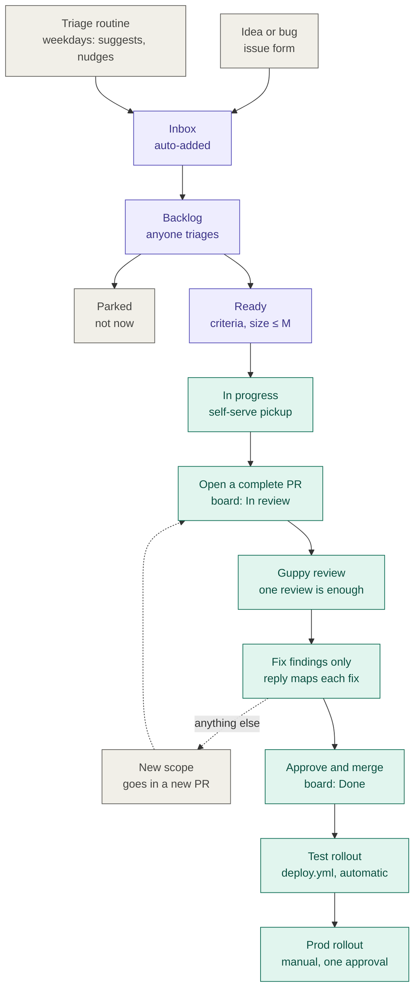
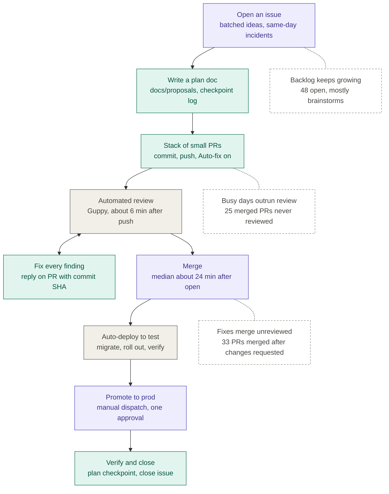

# How we work: the project board process

This is a guide for everyone on the team to the new way we get from an idea to code running in
prod. It covers how to file and triage issues on the GitHub project board, how to pick up work,
and what's expected of a pull request.

Most of us work on this project in our free time, so **there are no meetings, rotations or
deadlines.** You pull work when you have time, and an automated routine nudges but never decides.

- **Board:** [StockPortfolioManager project board](https://github.com/users/JohnFunkCode/projects/4)
- **The rules themselves:** [`issue-triage.md`](issue-triage.md) holds the statuses, priority
  meanings, the Ready bar, the board's views and workflows, and what the triage routine does. This
  guide walks through them and links there rather than restating them.

## The new process at a glance

Purple steps happen on the board, teal steps are the code path, and dashed arrows are the side
path for new scope.

## Using the board, step by step

### 1. File an issue

Use **New issue** in the repo and pick a template:

| Template | Use it for | What it asks |
|---|---|---|
| **Idea** | Anything you might want someday | One line, and why it matters |
| **Bug** | Something broken | What happened, and where |
| **Ready to build** | Work that's already well defined | Acceptance criteria and a size (required) |

Blank issues are still allowed. However you file it, the issue lands on the board in **Inbox**
within seconds. Capturing an idea should stay cheap, so don't polish it before filing.

### 2. Triage: anyone, whenever you pass by

Nobody owns triage. On weekday mornings the **triage routine** posts one suggestion comment on
each new Inbox issue, proposing an Area, Priority and Size with a reason for each, and naming
likely duplicates. Triaging is mostly accepting or adjusting that suggestion:

1. Set **Area**, **Priority** and **Size**.
2. Move the item to **Backlog**, **Ready** or **Parked**.
3. If it's a duplicate, or the work is already done, close it instead.

The routine only suggests; the fields and moves are people's decisions. Exactly what it does and
never does: [the triage routine](issue-triage.md#the-triage-routine).

### 3. Priority is an order, not a commitment

P1s get picked first, then P2s; P0 means broken or insecure in prod and goes to the maintainer.
No priority implies a date. The full table: [priority](issue-triage.md#priority-is-an-order-not-a-commitment).

### 4. Make it Ready

Only an item that passes [the Ready bar](issue-triage.md#the-ready-bar) moves to **Ready**. In
short: acceptance criteria a reviewer could check, a size of M or smaller, and no open questions
(`/feature-research <n>` in Claude Code helps with those). Before you pick up a Backlog item,
check it against the bar yourself.

### 5. Pick up work

The board's **Ready** view is the menu. To take an item, **assign yourself and move it to In
progress**. With only an hour to spare, look for small items labelled `good first issue` or
`help wanted`.

Letting go is just as easy: unassign yourself and move the item back to Ready. That's normal, not
a failure. If an In progress item goes quiet for 30 days, the routine asks once whether you're
still on it. It never unassigns anyone.

### 6. Open one complete PR

- **Open the PR when the work is complete,** not as a draft to keep pushing to. The automated
  reviewer reviews whatever is there when it looks.
- Put **`Closes #<n>`** in the description. Linking moves the issue to **In review**, the reviewer
  checks the PR against the issue's acceptance criteria, and the issue closes on merge.

### 7. One review, then fix only what it found

Each PR gets **one** automated review from Guppy, and one review is enough. A PR doesn't merge
until Guppy has reviewed it, and nobody waits for a second review.

- **Commits after the review only fix what it found.** Reply on the PR mapping each finding to its
  fix commit.
- **Anything else goes in a new PR,** so it gets its own review: a rework, a follow-up request, or
  an unrelated fix you noticed along the way.

(This rule is being written into `CLAUDE.md` and `AGENTS.md` in
[PR #490](https://github.com/JohnFunkCode/StockPortfolioManager/pull/490), so Claude and other
agents follow it too.)

### 8. Merge and ship

A maintainer approves and merges; the branch ruleset requires that approval. The board moves the
issue to **Done** on merge. `deploy.yml` then rolls the change out to **test** automatically.
**Prod** is a manual rollout (`prod-rollout.yml`) with a single approval, and prod is never
deployed automatically.

### Parking

Parking keeps the Ready list short. It isn't a judgment on the idea. Anyone can park an item, and
the routine lists Backlog items untouched for more than 120 days as candidates. To bring a parked
item back, comment on it and move it to Backlog.

## Board views

Use the **Inbox** view to triage, **Ready** to pick up work, **By Area** to see what's queued in
your area, and **Team in progress** to see who's on what. The board moves items itself when an
issue is added, a PR is linked, and an issue is closed, merged or reopened; you move items by hand
between Inbox, Backlog, Ready, Parked and In progress. Each view's filter and each workflow:
[board configuration](issue-triage.md#board-configuration).

## What changed: old process vs. new

### The old process

Purple steps were done by people, teal by Claude, grey by automation (CI and the reviewer).
Dashed boxes mark where the old process leaked; the numbers come from the activity between
2026-09-28 and 2026-10-29.

### Side by side

| | Old process | New process |
|---|---|---|
| **Capturing an idea** | A blank issue, often in batches | An issue form (Idea, Bug or Ready to build); blank still allowed |
| **Where ideas go** | Straight into one growing backlog | The board's **Inbox**, automatically |
| **Triage** | None in particular; the backlog just grew | Anyone, any time, helped by the routine's suggestion comment |
| **Prioritizing** | Implicit: whatever got picked next | Priority **P0/P1/P2**, as an order, never a date |
| **Deciding what's buildable** | No shared bar | The **Ready** bar: acceptance criteria, Size ≤ M, questions answered |
| **Ideas not wanted now** | Stayed open in the backlog | **Parked**: kept and searchable, out of the way |
| **Picking up work** | Mostly the maintainer, driving Claude | **Self-serve** from the Ready view, by anyone |
| **Stalled work** | Not tracked | A one-time nudge after 30 days of no activity; no one is unassigned |
| **Board status** | Updated by hand, if at all | Moves itself on add, PR link, merge, close and reopen |
| **Opening a PR** | Stacks of small PRs, sometimes pushed to after review | One **complete** PR, with `Closes #<n>` |
| **Review** | Guppy, with a fix-and-push loop | Guppy reviews **once**, and once is enough |
| **After the review** | Fixes, and sometimes new scope, merged unreviewed | **Findings only**; new scope goes in a new PR |
| **Merge and ship** | Merge, auto-deploy to test, manual prod rollout | Unchanged |

### Why we changed

- **The backlog had no exit.** Ideas went in, but nothing ranked them or said which were ready, so
  the list only grew. Triage, priorities, the Ready bar and Parked give every idea a next step
  without deleting any of them.
- **Work depended on one person.** Self-serve pickup from a Ready list with clear acceptance
  criteria lets anyone with an hour contribute.
- **Unreviewed code reached main.** Requiring one review before merging, and keeping post-review
  commits to the findings, closes the gap without adding a second layer of review, which a
  free-time team doesn't need.
- **No hard schedules.** Nothing in the new process has a deadline; the routine nudges and people
  decide.

## Quick reference

| I want to… | Do this |
|---|---|
| Record an idea | New issue → **Idea** template |
| Report a bug | New issue → **Bug** template |
| Help triage | Open the **Inbox** view; set Area, Priority, Size; move to Backlog, Ready or Parked |
| Find something to work on | Open the **Ready** view; assign yourself; move to **In progress** |
| Stop working on something | Unassign yourself; move it back to **Ready** |
| Ship it | Open one complete PR with `Closes #<n>`; fix only Guppy's findings; get approval |
| Add something after review | Open a **new** PR |
| Shelve an idea | Move it to **Parked** |
